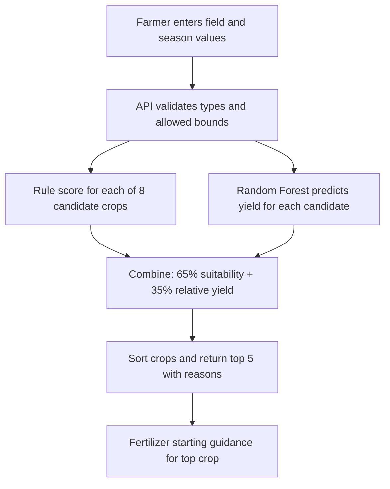

# Crop Recommendation System — Project Defense Guide

This guide is based on the code and artifacts currently in this repository. It separates implemented features from research and future work so you can answer the panel accurately. Do not claim that a model was trained on real farm measurements or that a disease classifier is running unless you replace the current components and verify those claims.

## 1. A short presentation you can speak

> “Our project is an AI-assisted Crop Recommendation System. A farmer enters the location, season, soil type, soil pH, nitrogen, phosphorus, potassium, temperature, rainfall, humidity, and farm area. The dashboard compares eight crops using a transparent rule-based suitability score, then combines that score with yield estimates from a Random Forest regression model. It returns a ranked shortlist and basic fertilizer guidance. The system also has a crop-photo analysis screen and a small chatbot. The crop/yield service is implemented locally in Python and can run with the React dashboard through Docker. We treat the results as decision support, not as guaranteed agronomic advice. Our next research step is to validate the recommendations against trusted local data and build and test a dedicated disease image classifier on field images.”

If asked whether disease detection is trained locally, say:

> “Not in the current version. The disease screen sends the uploaded image to a configured remote multimodal AI service through a Supabase Edge Function. It is not a locally trained disease classifier, it does not currently provide a measured probability, and it needs the correct Supabase and provider configuration. A dedicated, validated image model is planned work.”

## 2. What the current project actually does

| Component | Current implementation | What to say |
|---|---|---|
| Dashboard | React + TypeScript + Vite | User interface for entering farm details and reviewing ranked crops. |
| Crop shortlist | Python/Flask API; hand-coded crop requirement ranges and scoring | A transparent heuristic/rule score ranks eight crops. It is not a trained crop-classification model. |
| Yield estimate | Scikit-learn `RandomForestRegressor` saved as a Joblib artifact | Regression estimates yield in tons per hectare from the supplied structured fields. |
| Combined ranking | 65% rule-based suitability score + 35% normalized yield score | The dashboard/API chooses the highest combined score; this weighting is a project design choice, not a learned or experimentally optimized weight. |
| Fertilizer hint | Threshold calculations from target midpoints in the crop requirement table | Starting guidance only. It is not a lab-calibrated fertilizer prescription. |
| Disease photo analysis | Supabase Edge Function forwards the image to a Lovable AI Gateway / Gemini multimodal model | Remote generative image analysis, not a disease model trained as part of this repository. It needs a configured secret and deployed function. |
| Chatbot | Existing Supabase-backed chat interface/function | A conversational assistant; its answers are not evidence of a crop/yield model prediction. |
| Packaging | Docker Compose runs frontend and Python API | Docker packages and runs the software; Docker itself does not train the models. |

The main implementation files are `src/pages/Dashboard.tsx`, `ml_backend/app.py`, `ml_backend/utils/recommendations.py`, `ml_backend/utils/preprocessing.py`, `ml_backend/training/`, and `supabase/functions/crop-disease-detect/index.ts`.

## 3. How one recommendation is produced

1. The frontend sends a JSON object to `POST /api/recommendations`.
2. The API checks categorical choices and broad technical bounds. These bounds reject nonsensical inputs; they are **not** “safe crop” or optimum ranges.
3. For each candidate crop, a heuristic calculates pH, N, temperature, rainfall, and season sub-scores. The code takes their arithmetic mean. P and K are in the crop requirement table but are not currently used in the crop ranking score. Humidity and soil type are collected but are not currently used by the rule score either.
4. The saved Random Forest estimates yield for each candidate using the input row transformed by the saved preprocessor.
5. Yield estimates are min-max scaled within the eight candidates for this single request. That relative score is combined as `0.65 × suitability + 0.35 × relative_yield`. It is a ranking score, not a probability or calibrated confidence.
6. The top five are returned. Fertilizer suggestions are generated from differences between the farmer's NPK values and the midpoint of the selected crop's stored ranges.

**Important code detail:** the model input feature list includes `crop`, `season`, soil type, location and numeric features. But the current preprocessor has only categorical and numeric transformations for those columns; quarterly weather columns are only used to form sequences for the optional LSTM pipeline, not for the deployed Random Forest feature matrix.

## 4. Dataset and training facts to disclose

- The included CSV is `ml_backend/data/raw/multisource_agricultural_dataset.csv`: **3,000 rows × 23 columns**.
- Target: `yield` (tons/ha). Fields include state, district, crop, season, soil type, pH, N/P/K, temperature, rainfall, humidity, area, previous yield, quarterly temperature/rainfall, and target yield.
- The repository’s `training/generate_dataset.py` generates this CSV with a fixed seed. It is synthetic/generated data, not a government survey, laboratory record, or field experiment. Say so plainly.
- `training/preprocess.py` creates an 80/20 train/test partition with seed 42. The current pipeline fits encoders/scalers on the full dataset **before** splitting. That leaks information from the held-out partition into preprocessing and makes the reported holdout results optimistic. A corrected research run must split first, fit preprocessing only on training data, then transform validation/test data.
- The deployed model is the Random Forest artifact `ml_backend/models/random_forest/rf_model.joblib`. Reproduction steps and model comparison scripts are in `ml_backend/training/`.
- Archived metrics in `ml_backend/models/metrics.json` report Random Forest R²=0.9919, MAE=0.6992 and RMSE=1.8865. These are scores from the generated data and original pipeline, not proof of real-world accuracy. Because the target itself is generated and preprocessing happened before splitting, do not present these as field performance.
- DNN, LSTM and Hybrid DNN+LSTM training scripts/artifacts are included. They are comparative/offline artifacts; the live recommendation API loads Random Forest. Archived LSTM metrics are much worse (R²≈0.45, MAE≈7.39, RMSE≈15.50), so do not say all methods performed equally well.

### Training pipeline (plain explanation)

1. Inspect column names, missing values, units, label meaning, duplicates and provenance.
2. Split by time/location/farm where possible to test generalization; keep a final untouched test set.
3. Fit imputation and categorical/numeric preprocessing on training records only.
4. Train candidate regressors on the training set.
5. Tune on validation data only; compare with a simple baseline such as predicting the training mean.
6. Evaluate once on the held-out test data using MAE, RMSE, R² and residual plots; include confidence intervals or repeated/grouped splits where feasible.
7. Save the fitted preprocessing pipeline and model together; serve the exact same transformation at inference time.
8. Validate with agronomists and real local records before making operational recommendations.

## 5. Inputs, scales, and interpreting low/high values

The table below describes units and general meaning. A number alone cannot establish that a field is safe or that a crop will succeed. Actual interpretation depends on sampling method, soil test units, crop, variety, growth stage, region, irrigation, and local recommendations.

| Input | Meaning / unit in this project | What low or high can imply; how to explain it |
|---|---|---|
| pH | 0–14 scale; logarithmic acidity/alkalinity measure; app accepts 0–14 | Low = acidic, high = alkaline. Either extreme can reduce availability of some nutrients or create toxicity problems. The crop table defines different preferred intervals. Soil pH must be measured with a stated lab method; pH values are not linear. |
| Nitrogen (N) | App says kg/ha | Essential for vegetative growth. Too little can limit growth; excessive N can cause lush growth, lodging, delayed maturity, losses to water/air and more disease pressure. Soil-test methods and whether values mean available N or fertilizer recommendation must be specified. |
| Phosphorus (P) | App says kg/ha | Supports roots, energy transfer and reproductive growth. Low availability can constrain roots/flowering; excess can be environmentally harmful and interact with micronutrients. Many lab reports express P or P₂O₅ differently; verify conversion before using a lab result. |
| Potassium (K) | App says kg/ha | Supports water regulation, enzyme function and stress tolerance. Deficiency can weaken growth and quality; excess may disturb nutrient balance. Labs may report K or K₂O; units/forms must match. |
| Temperature | °C; project uses one value | Too cold or hot for a crop/stage can impair germination, flowering or grain/fruit set. One average value hides daily extremes and crop stage. |
| Rainfall | mm, treated by the UI as seasonal/annual aggregate | Too little can mean drought/water stress; too much can cause waterlogging, erosion or disease. The project’s rule descriptions call it seasonal/annual, so users must use the same period assumed by the range. |
| Humidity | % | Affects evapotranspiration and disease environment. The backend accepts it, but it is not currently used in the crop ranking rule or Random Forest feature pipeline. |
| Soil type | Categorical label | Texture/mineral properties affect water holding, drainage and nutrient retention. The dashboard has categories such as Clay, Loam, Sandy Loam, Black Soil, Red Soil and Alluvial; these are broad labels and can hide substantial local variation. Current crop scoring does not use this field. |
| Season | Kharif, Rabi, Whole Year, Zaid | A broad Indian crop-calendar category. It varies by state, rainfall onset, irrigation, cultivar and local sowing window. Current crop scoring gives a season suitability sub-score from a hand-coded list. |
| Area | hectares (ha) | Used to multiply estimated tons/ha into an estimated farm total. It does not itself make a crop biologically suitable. One hectare = 10,000 m². |
| Previous yield | tons/ha, optional | Could provide farm history, but this synthetic-data feature may strongly affect the model. It should be recorded consistently and compared with the same crop/area/season basis. |
| State/district/crop | Categories | Context and candidate identity for the yield model. Region categories seen during training matter; an unseen category is ignored by the encoder rather than magically learned. |

### Actual crop ranges coded in this version

These are the literal ranges in `ml_backend/utils/recommendations.py`, in units as encoded. Call them **prototype heuristic ranges**, not universally validated thresholds or guarantees.

| Crop | pH | N | P | K | Temperature °C | Rainfall mm | Encoded seasons |
|---|---:|---:|---:|---:|---:|---:|---|
| Rice | 5.5–7.5 | 100–150 | 40–80 | 30–60 | 20–38 | 900–2500 | Kharif, Whole Year |
| Wheat | 6.0–7.8 | 80–130 | 35–65 | 30–50 | 10–26 | 400–900 | Rabi |
| Maize | 5.8–7.2 | 75–120 | 30–55 | 25–45 | 18–32 | 450–1150 | Kharif, Rabi, Zaid |
| Cotton | 6.0–8.2 | 70–110 | 30–50 | 30–60 | 20–36 | 550–1250 | Kharif |
| Sugarcane | 6.0–8.0 | 160–240 | 60–100 | 80–140 | 20–40 | 1100–2800 | Whole Year |
| Pulses | 6.0–7.8 | 20–45 | 40–70 | 20–45 | 15–30 | 300–800 | Kharif, Rabi, Zaid |
| Soyabean | 6.0–7.5 | 30–55 | 50–80 | 30–55 | 18–34 | 550–1050 | Kharif |
| Groundnut | 5.5–7.2 | 25–50 | 40–65 | 40–70 | 20–35 | 450–1000 | Kharif, Zaid |

Inside a preferred interval, that sub-score is 100. Outside it, the code lowers the score by a hand-written distance formula, with a floor; it does not reject the crop as unsafe. “Below” or “above” therefore means **lower/higher fit score**, not an agronomic diagnosis. The program validates pH 0–14; N/P/K 0–500; temperature −10–60°C; rainfall 0–10,000 mm; humidity 0–100%; area 0.01–100,000 ha; previous yield 0–1,000 tons/ha. Those are input-validation bounds, not crop tolerances.

## 6. Algorithms and abbreviations

| Name | Full form and definition | Role here |
|---|---|---|
| ML | Machine Learning: algorithms learn patterns from examples to make predictions | Random Forest yield regression. |
| Random Forest (RF) | Ensemble of decision trees trained on bootstrapped samples and randomized features; regression aggregates tree outputs | Deployed yield estimator; 150 trees, maximum depth 15, seed 42. It is robust for tabular nonlinear patterns, but it cannot fix synthetic or biased data. |
| Decision tree | A sequence of feature-threshold splits that leads to a numeric prediction or class | A constituent of the Random Forest. |
| Regression | Predicting a continuous quantity | Yield is continuous, so the yield task is regression. |
| Heuristic / rule-based score | Human-coded if/else logic and arithmetic, not learned from labelled outcomes | Crop suitability score. |
| One-hot encoding | Represent each category with binary indicator columns | Encodes crop, state, district, season and soil type. Unknown categories are ignored by the fitted encoder. |
| StandardScaler | Centers numeric data by its training mean and scales by standard deviation | Prepares numeric features. Tree models generally do not require this scaling; the project preprocessing applies it. |
| DNN | Deep Neural Network: multilayer neural network | Included as an offline yield-model comparison. |
| LSTM | Long Short-Term Memory: recurrent neural network designed for sequence data | Included for quarterly weather sequence experiment. Current API does not use it. |
| Hybrid DNN + LSTM | Combines a tabular DNN branch with an LSTM sequence branch | Included comparison artifact; not the deployed API model. |
| MAE | Mean Absolute Error: average absolute prediction error, in target units | Easier direct interpretation; lower is better. Here tons/ha. |
| RMSE | Root Mean Squared Error: square root of average squared error; penalizes large errors more | Lower is better; here tons/ha. |
| R² | Coefficient of determination: comparison to predicting the mean on the evaluated sample | 1 is ideal, 0 is mean-baseline-like, negative is worse than that baseline. It is not “accuracy percent.” |
| CNN | Convolutional Neural Network: neural network using spatial filters to learn image features | A standard candidate for a future trained disease classifier, not the present disease implementation. |
| Grad-CAM | Gradient-weighted Class Activation Mapping: uses class gradients to make a coarse heatmap of influential image regions in a differentiable CNN | A proposed explainability view for a future CNN. It cannot be directly extracted from the current remote Gemini text response. |
| API | Application Programming Interface: a defined way for software components to exchange requests and responses | React calls the Flask JSON endpoints. |
| IPM | Integrated Pest Management: combine monitoring, cultural, biological and carefully selected chemical measures | Safer framework for disease guidance; use local agricultural officers and product labels. |

### Why Random Forest was chosen for the live yield API

It is a suitable baseline for mixed categorical and numeric tabular inputs, can model nonlinear interactions without assuming a linear relationship, and is simpler to package and serve than the included neural networks. It is not claimed to be universally best. A fair comparison needs a corrected data split, a baseline, suitable cross-validation, data provenance, and independent real-world evaluation. The saved comparison scores alone do not establish superiority.

## 7. Disease analysis: current reality and honest demo

### What happens now

1. The browser checks that an uploaded file is an image and under 10 MB.
2. It displays a preview and converts the file to a base64 data URL.
3. The client invokes the Supabase `crop-disease-detect` Edge Function.
4. The function sends the image and a prompt to `google/gemini-3-flash-preview` through the Lovable AI Gateway, using `LOVABLE_API_KEY` stored server-side.
5. The model generates a text analysis. The prompt asks for disease, confidence wording, symptoms, cause, broad treatment and prevention. The application does not independently validate that text or compute calibrated confidence.

This can be demonstrated as **AI image analysis** only if the Supabase function is deployed and secrets/config are valid. Do not describe it as “we trained a CNN disease model.” Do not present its generated “High/Medium/Low” wording as a measured model probability. Internet/service availability is required.

### If the panel asks how the disease model will be built next

1. Define a limited scope first: selected crops and disease/healthy classes relevant to the target region.
2. Gather expert-labelled images with consent and documented licensing. Public starting points include PlantVillage (controlled-background images) and PlantDoc (more varied web/field-like images). These are research datasets, not a substitute for local field validation.
3. Deduplicate near-identical images and split by source/plant/location/session before augmentation, to prevent leakage.
4. Resize and normalize images; use augmentation only on the training partition (small rotations, flips, lighting changes that preserve diagnosis).
5. Compare a transfer-learned lightweight CNN (e.g., MobileNet/EfficientNet) with a simple baseline. Keep validation data for model selection and a final field-like test set untouched.
6. Report per-class precision, recall, F1, confusion matrix, macro-F1, calibration/uncertainty, and field performance. Accuracy alone can hide poor rare-disease recall.
7. Add an “uncertain / unsupported image” outcome and human escalation; never force a disease label on every photo.
8. Generate Grad-CAM overlays only for the trained CNN and check whether the highlighted region corresponds to visible symptoms. A heatmap is an explanation aid, not proof of a correct diagnosis.
9. Test different devices, sunlight/shade, backgrounds, leaf ages and symptom stages with local agronomists; track false negatives and update with versioned data/model cards.

### Websites/apps to explore for a visual demonstration

- [Plantix](https://plantix.net/en/) — commercial crop-photo diagnosis/advisory app; use it to show the type of user experience, not as a scientific benchmark for this project.
- [PlantVillage Nuru](https://iita.org/digital-tool/plantvillage-nuru/) — an AI-based field diagnosis smartphone tool focused on cassava disease/pest damage; primarily an app, not a generic browser classifier.
- [PlantVillage dataset paper and data](https://github.com/spMohanty/PlantVillage-Dataset) — inspect example image classes and explain a supervised image-classification dataset.
- [PlantDoc dataset and paper](https://arxiv.org/abs/1911.10317) — useful to explain why field backgrounds and realistic image variation matter.
- [Grad-CAM paper](https://arxiv.org/abs/1610.02391) — reference for heatmaps on a future differentiable CNN. The historic online demo link may not remain available; cite the paper or use a locally generated overlay instead.

For an easy classroom illustration, show one labelled PlantVillage/PlantDoc image, the model’s predicted class, a confidence calibration note, and (only for your own trained CNN) a Grad-CAM overlay. Label any third-party site as a reference example, never as your system’s output.

## 8. Research-informed project plan (what we should say)

Use this honest wording:

> “We reviewed research and existing tools to identify the core design requirements: structured soil/climate inputs for crop planning, image-based disease support, explainable outputs, and real-world validation. PlantVillage research demonstrates that image classification is feasible on curated leaf datasets, while PlantDoc and later field-image research highlight that varied backgrounds and lighting make field deployment harder. These findings guided our modular design and our planned validation steps. Our present code is a prototype; our included yield data are synthetic, so we do not claim field-validated performance.”

Do **not** say “no research has done this” or “we are the first.” Prior research and existing tools cover crop recommendation and plant disease image analysis. A defensible project contribution is an integrated, student-built prototype plus a clear, testable plan to improve local validation and transparency. Only say you read a paper if you actually read it; cite it on the presentation slide.

### Proposed steps before claiming a validated system

1. **Problem and users:** specify target state/district, crop set, season and farmer workflow with an agriculture expert.
2. **Literature review:** search for crop suitability methods, official crop calendars, soil test methods, disease datasets and field validation; record paper, method, dataset, region, metrics and limitation in a comparison table.
3. **Requirements:** agree units, sensor/lab protocols, supported crops, disease classes, languages, internet constraints and safety requirements.
4. **Data:** replace or supplement synthetic yield data with properly licensed, traceable, representative farm/official records; document collection and quality checks.
5. **Model design:** establish simple baselines; train/evaluate yield regression and disease image classification as separate tasks.
6. **Evaluation:** prevent leakage, use location/time grouped splits, report error and classwise metrics, test uncertainty and edge cases, obtain expert review.
7. **Product:** show inputs, source of each value, reasons, units, limitations, privacy notice, fallback and referral path.
8. **Deployment:** version model + preprocessing; containerize; health-check API; log errors safely; monitor performance and maintain rollback.
9. **Pilot:** test with intended users and agricultural staff; collect feedback and real outcomes before claiming benefit.

## 9. Likely panel questions and short answers

1. **What problem are you solving?** Farmers must compare soil/climate conditions and seasonal crop options; the dashboard organizes these inputs and provides a ranked decision aid.
2. **What is the main objective?** Recommend a shortlist of crop options from farm conditions, estimate yield for candidates, and provide an accessible interface for advice.
3. **What is the input and output?** Inputs are the farm/soil/climate/season values shown above; outputs are a top-five crop ranking, fit score, model yield estimate and basic fertilizer hint.
4. **Is the recommendation ML?** It is hybrid: a hand-coded suitability heuristic plus a Random Forest yield regression. The suitability score is not trained ML.
5. **What is the primary trained algorithm?** Random Forest Regression; the current API loads its saved model and preprocessor.
6. **What is the target variable?** `yield`, expressed in tons per hectare in the project.
7. **How was it trained?** The included script preprocesses records, splits 80/20 using seed 42, trains 150 decision trees (max depth 15), evaluates and saves a Joblib artifact. Add the important caveat: preprocessing is fitted before the split, so this run has leakage and needs correction.
8. **What dataset did you use?** The repository includes 3,000 rows generated by code. It is synthetic, not measured field data. We use it to demonstrate the pipeline, not to claim real-world accuracy.
9. **Why does R² look very high?** It is an archived score on generated data whose target follows the generator’s patterns, plus preprocessing leakage. It is not evidence of comparable field performance.
10. **Explain MAE vs RMSE.** Both measure regression error in tons/ha; MAE is average absolute error, RMSE penalizes large errors more. Lower is better.
11. **Is R² accuracy?** No. It measures variance explained relative to a mean prediction on that dataset; it is not classification accuracy or a probability.
12. **Why compare DNN/LSTM/hybrid?** To explore different structures; DNN handles tabular values, LSTM is designed for sequences, hybrid combines them. The deployed service still uses RF, and the recorded LSTM result is notably weaker.
13. **Why is season used?** Crop suitability depends on sowing windows and monsoon/winter cycles; current categories are broad and must be localized by state and calendar.
14. **What does pH mean?** A logarithmic measure of soil acidity/alkalinity; lower is more acidic and higher more alkaline. Crop tolerance differs; measure it with a soil test.
15. **What if a value is too low or high?** The heuristic lowers a score outside its stored preferred range; it does not prove a crop is unsafe or tell a farmer how to amend the soil. Recommend soil testing and expert advice.
16. **Are your NPK values scientifically calibrated?** The app labels them kg/ha, but actual lab outputs may use different chemical forms and methods. The prototype ranges need local agronomic validation and unit definitions.
17. **Why ask humidity and soil type if they are not used?** They are captured in the current form/API, but the crop rule and live RF preprocessor do not currently use them as described. This is a known feature gap for a future version; do not claim they influence current ranking.
18. **How are crops ranked?** The code averages suitability sub-scores, then combines 65% rule score and 35% within-request normalized RF yield score. The weights are fixed design settings, not trained weights.
19. **Is the match score a probability?** No. It is a heuristic/relative ranking score and should not be interpreted as likelihood of success.
20. **Does the yield represent total farm yield?** The model predicts tons/ha; total is estimated by multiplying by area. The total inherits all model errors and assumptions.
21. **How does disease prediction work?** In the current implementation, a remote multimodal Gemini model analyzes the image through a Supabase Edge Function. It is not a locally trained disease classifier.
22. **What algorithm is used for disease?** The provider model’s internal architecture is not trained or controlled by this repository. We should call it remote generative image analysis, not claim CNN/MobileNet unless we implement one.
23. **How do you know its confidence is accurate?** We do not currently measure or calibrate confidence. The prompt asks for verbal confidence; this is generated text and must not be represented as a validated probability.
24. **What if disease image is wrong or unclear?** The current screen displays the remote service response. The intended safe workflow is to report uncertainty and refer to an agriculture officer/KVK; the current generated answer is not a lab diagnosis.
25. **How will you train disease detection?** Use expert-labelled crop/disease images, clean duplicates, group splits, train a CNN/transfer-learning baseline, report per-class F1 and field-test it, then add explainability and uncertainty.
26. **Why not only accuracy?** Class imbalance can hide rare-class failures. We also need per-class precision/recall, macro-F1, confusion matrix, calibration, and real field testing.
27. **What is novelty?** Avoid claiming first-ever. Our contribution is the integrated prototype and an educational, inspectable pipeline; uniqueness must be defined and supported only after a proper literature review.
28. **How do you handle missing/invalid input?** API validation rejects nonnumeric, nonfinite or out-of-range numeric values and invalid category choices; the UI also constrains choices. The broad bounds are validation checks, not agronomic recommendations.
29. **How does Docker help?** It packages the React frontend and Python API into repeatable containers and starts them together via Compose. It does not improve prediction accuracy or train the models.
30. **Can it run offline?** The dashboard/API containers can run locally, but current disease and chatbot features rely on Supabase/provider services and network configuration.
31. **What are the major limitations?** Synthetic yield data, preprocessing leakage in the archived evaluation, hand-coded generalized ranges, fields collected but unused in ranking, no local trained disease classifier, external service dependence, and no field validation.
32. **What is the next improvement?** Fix the data pipeline and evaluate on traceable local data, define units with an agronomist, use region-specific calendars, add field validation, and train a dedicated disease model with uncertainty.
33. **How do you prevent harmful fertilizer advice?** Treat the current formula as illustrative only; fertilizer plans should use soil-test reports, local recommendations, crop stage and expert review. The disease prompt also avoids exact pesticide doses and advises label/expert guidance.
34. **How do you protect uploaded images?** The image is sent to the configured third-party service through Supabase. Before deployment, disclose this flow, inspect provider retention/privacy settings, limit access and avoid uploading sensitive personal information.

## 10. Demo sequence for the panel

1. Open the dashboard and state the target user and problem.
2. Explain each field and its unit before entering sample values; clearly call sample values illustrative.
3. Submit and explain one crop’s range fit, one limitation, the combined rank, and why the match score is not probability.
4. Show yield per hectare and farm-total multiplication; distinguish an estimate from measured outcome.
5. Open disease scan. If the remote function is configured, upload a clear leaf image and describe the output as remote AI-generated guidance. If it is unavailable, show the interface/code flow and say a service secret/deployment is required; do not pretend an offline model is running.
6. Show `ml_backend/data/raw/multisource_agricultural_dataset.csv`, `ml_backend/training/preprocess.py`, `ml_backend/training/train_rf.py`, `ml_backend/models/metrics.json`, and `ml_backend/app.py` in VS Code to demonstrate data, training, evaluation and serving.
7. Close with limitations and the validation plan. Acknowledging limitations makes the claim defensible.

## 11. Research references and what each supports

These are useful references for the proposed research plan; listing them here does not mean the current project already implements their models or used their datasets.

1. Mohanty, Hughes & Salathé (2016), [Using Deep Learning for Image-Based Plant Disease Detection](https://doi.org/10.3389/fpls.2016.01419). Demonstrates image classification using PlantVillage; supports feasibility on curated images, not automatic generalization to field conditions.
2. Singh et al. (2020), [PlantDoc: A Dataset for Visual Plant Disease Detection](https://arxiv.org/abs/1911.10317). Introduces varied in-the-wild images and discusses the data challenge for visual disease detection.
3. Selvaraju et al. (2017), [Grad-CAM: Visual Explanations from Deep Networks via Gradient-Based Localization](https://openaccess.thecvf.com/content_ICCV_2017/html/Selvaraju_Grad-CAM_Visual_Explanations_ICCV_2017_paper.html). Supports the planned heatmap explanation for a suitable differentiable CNN.
4. FAO, [Soil reaction (pH)](https://www.fao.org/4/ar875e/ar875e.pdf). Background on pH and nutrient availability; crop-specific limits still require local agronomic sources.
5. [PlantVillage dataset repository](https://github.com/spMohanty/PlantVillage-Dataset). Dataset/source reference; check its current terms and cite the associated paper when using it.
6. [PlantDoc dataset repository](https://github.com/pratikkayal/PlantDoc-Dataset). Dataset and license reference; verify permission, attribution and class suitability before use.

For a real literature review, add crop-specific official sources from ICAR/state agriculture universities for the target district, soil-testing standards, and peer-reviewed yield studies. Record year, geography, data, method, metrics, findings and limitations for each paper. Do not cite this guide as evidence that those papers were already reviewed by the project team.
